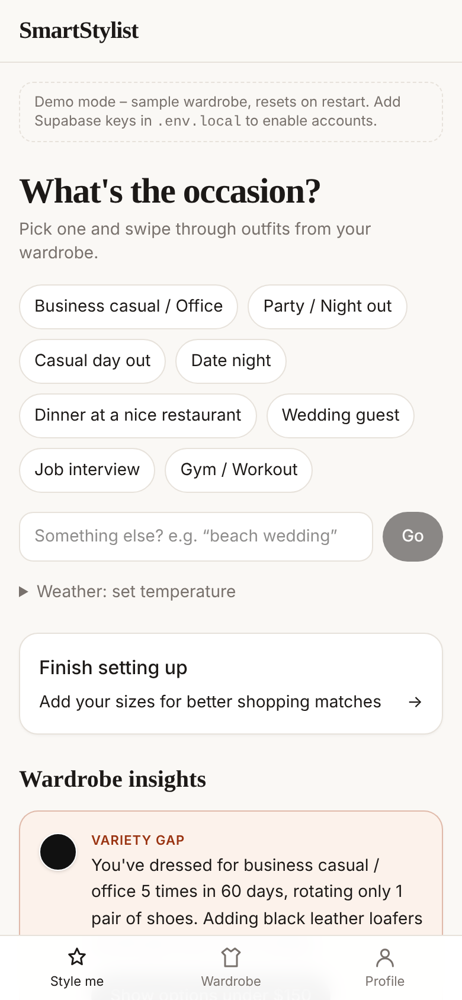
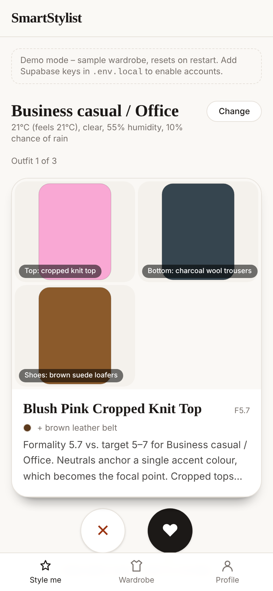
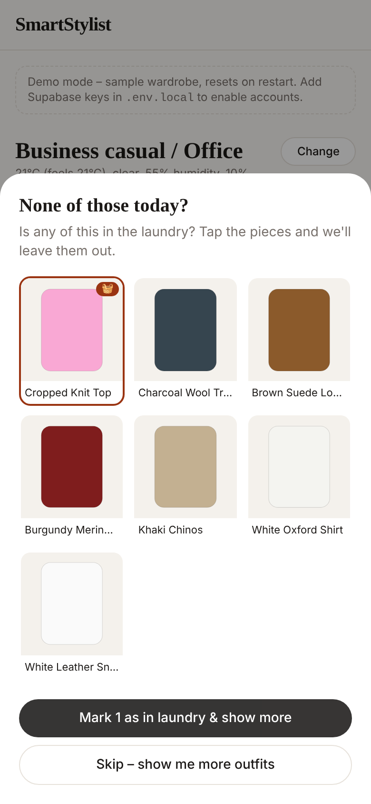
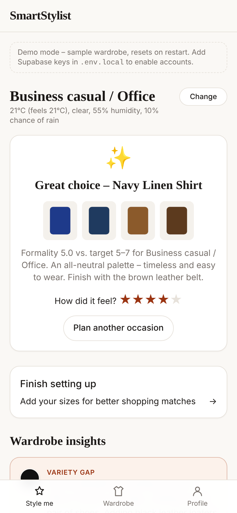

# SmartStylist

An AI wardrobe and personal stylist. Photograph your clothes, get daily outfits matched to the occasion, the live weather, your body shape and **your own fit rules**, and get shopping suggestions within your budget when your wardrobe has a gap.

<p>




</p>

Architecture, design decisions and the evaluation of the original brief are in **[docs/ARCHITECTURE.md](docs/ARCHITECTURE.md)**.

## Features

- **Wardrobe onboarding**: photo → downscaled on-device (EXIF/GPS stripped) → Claude vision extracts category, colour hex, pattern, fabric, fit, length, formality 1–10 and seasons → you review → saved. Optional background removal (remove.bg) and Fashion-CLIP embeddings.
- **Body shape**: MediaPipe runs **in the browser** and measures shoulder, waist and hip from your silhouette. The photo never leaves the device. A tape-measure option and a manual override are available.
- **Occasion → swipe deck**: after login you pick an occasion (office, party, …) and get 3 outfits as swipeable cards. Right = wear it (logged, rate later); left = not today. After 3 rejections a popup shows the pieces with their photos and asks *"Is any of this in the laundry?"* – mark them or skip. The next 3 outfits avoid everything already suggested (only a category with no alternatives, e.g. your only office shoes, is reused). Drag, ✕/♥ buttons and ←/→ keys all work.
- **Laundry**: items in the laundry are left out of suggestions until you mark them clean, or automatically after 7 days. Manage them from the Wardrobe tab.
- **Outfits include accessories**: an optional belt, watch, bag, scarf, etc., added only if it keeps the colour story. Scarves only appear when it's cold.
- **Stylist engine**: a deterministic rules engine (formality, colour harmony, body rules, weather, freshness) builds candidate outfits; Claude picks and explains them. It works without an AI key too.
- **Override layer**: for each fit attribute, choose *Never / Stylist decides / Always OK*, plus avoid-colours, avoid-patterns, sleeve whitelist, per-rule toggles and free-text notes. Your rules always beat body-type advice.
- **Gap analysis → Amazon**: missing pieces, formality ceilings, weather gaps and "you keep wearing the same shoes" insights turn into product specs **in your size**, searched on Amazon with your Associates tag and ranked by budget, style match and urgency.

## Quick start

```bash
npm install
```

```bash
npm run dev
```

With no environment variables the app runs in **demo mode**: a seeded 16-piece wardrobe, an in-memory store, the rules-engine stylist, a mock shopping catalogue, and a default or manual temperature. Open http://localhost:3000.

### Full setup

1. Copy `.env.example` to `.env.local` and fill in what you have. Every integration is optional and degrades gracefully.
2. Create a Supabase project, then apply the schema:
   ```bash
   npx supabase db push
   ```
   or paste the files in `supabase/migrations/` into the SQL editor, in order.
3. In Supabase Auth, add `http://localhost:3000/auth/callback` (and your production URL) to the redirect URLs.

| Variable | Enables |
|---|---|
| `NEXT_PUBLIC_SUPABASE_URL`, `NEXT_PUBLIC_SUPABASE_ANON_KEY` | Accounts, persistence, image storage |
| `ANTHROPIC_API_KEY` | AI garment tagging and stylist notes (`STYLIST_MODEL`, `STYLIST_EFFORT` optional) |
| `OPENWEATHER_API_KEY` | Live weather from the device location |
| `AMAZON_ASSOCIATE_TAG` | Affiliate tag on every Amazon link (`AMAZON_DOMAIN` for other marketplaces) |
| `SERPAPI_API_KEY` | Live Amazon product listings (via SerpAPI's Amazon engine) |
| `REMOVE_BG_API_KEY` | Background removal when saving items |
| `FASHION_CLIP_ENDPOINT` | 512-d visual embeddings (pgvector) |

## Scripts

- `npm test`: engine test-suite (colour harmony, body classification, override precedence, recommendations, gaps, product ranking)
- `npm run lint`: TypeScript check
- `npm run build`: production build

## Project layout

```
src/lib/engine/     deterministic styling core (pure TS, portable to React Native)
src/lib/ai/         Claude: garment tagging + stylist re-ranker (structured outputs)
src/lib/body/       body-shape classifier + on-device MediaPipe measurement
src/lib/shopping/   provider interface (SerpAPI, mock) + ranking
src/lib/data/       Repository interface → Supabase or in-memory demo
src/app/            pages + API route handlers
supabase/migrations schema, RLS, storage policies, triggers, vector search
```
