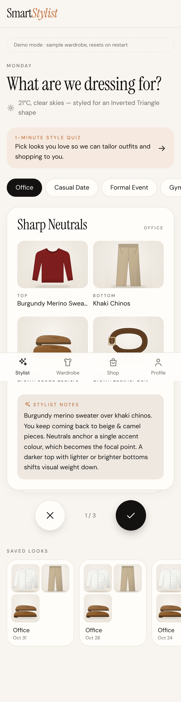
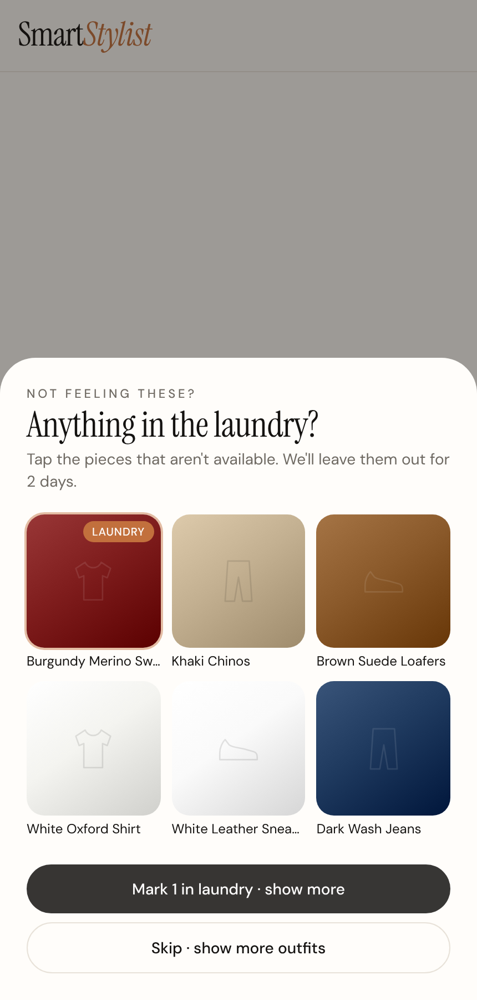
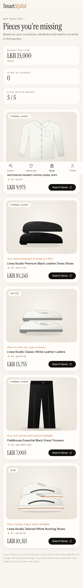
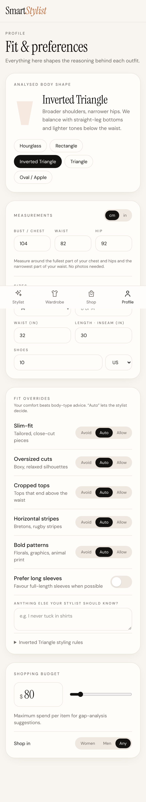
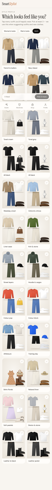

# SmartStylist

An AI wardrobe and personal stylist. Photograph your clothes, get daily outfits matched to the occasion, the live weather, your body shape and **your own fit rules**, and get shopping suggestions within your budget when your wardrobe has a gap.

<p>






</p>

Architecture, design decisions and the evaluation of the original brief are in **[docs/ARCHITECTURE.md](docs/ARCHITECTURE.md)**.

## Features

Four tabs: **Stylist · Wardrobe · Shop · Profile**.

- **Stylist**: pick an occasion from the chips (Office, Casual Date, Formal Event, Gym, Party, or "Other…" for free text) and an outfit card appears straight away. Swipe right (or ✓) to wear it; it's saved to *Saved looks* and logged. Swipe left (or ✕) to skip. After 3 skips a sheet shows the pieces with their photos and asks *"Anything in the laundry?"* – mark them or skip. The next 3 outfits avoid everything already shown; only a category with no alternatives (e.g. your only office shoes) is reused. This continues until the combinations run out. Drag, buttons and ←/→ keys all work.
- **2-day rules**: laundry items come back automatically after 2 days, and a rejected outfit isn't suggested again for 2 days.
- **Style quiz** (`/style`): outfit images for your gender (both for "Any"). Tap the ones you'd wear and we infer your style, e.g. *Classic & Minimal*, plus your preferred palettes. This tilts outfit picks and puts a style keyword into shopping searches ("minimalist", "boho"…). The looks are illustrated flat-lays; each has an `image_url` slot for curated photos.
- **Learns from history**: when you choose a similar style **twice** (same colour family, garment type, pattern, fit, colour scheme or top+bottom pairing), it becomes a preference that boosts future outfits and shopping picks. Two rejections create a soft dislike. Profile → *What we've learned* lists everything, and you can remove anything that's wrong.
- **Wardrobe**: pieces grouped by category, each showing availability, colour, pattern and a formality bar. Tap a piece to **edit its details**, **change its photo**, put it in the laundry or remove it. The + button adds pieces: select **several photos at once**, and Claude reads each one so you can review it, then "Save & next".
- **Shop**: gap analysis across your main occasions, your outfit history and the laundry. It covers missing pieces, formality ceilings, "only one gym top", backups for laundry items and weather gaps. Each gap gets one pick **in your size, in your style and liked colours**, split into within-budget and above-budget sections. The store is **Daraz** by default (free, no key; daraz.lk in LKR), and Amazon is an option. Budgets convert between currencies.
- **Profile**: body shape is calculated from your bust/waist/hip measurements (no photos), or you pick it yourself. It also holds sizes (tops, dress/frock, waist, length/inseam, shoes), fit overrides (*Avoid · Auto · Allow*, which always beat body-type advice), "prefer long sleeves", and the per-item budget. Changes save automatically.
- **Sample imagery**: a built-in library of studio-style product illustrations (26 garment types, in any colour, with stripes, denim, knit and floral textures) served from `/art/<kind>/<HEX>.svg`. They're used for the demo wardrobe, any piece without a photo, sample shop listings and the style quiz. Original artwork, so there are no licensing issues; real photos replace them automatically when present.
- **Stylist engine**: deterministic rules (formality, colour harmony, body shape, weather, freshness, accessories) build the candidates; Claude picks and explains them. It works without an AI key too.

## Quick start

```bash
npm install
```

```bash
npm run dev
```

With no environment variables the app runs in **demo mode**: a seeded 16-piece wardrobe, an in-memory store, the rules-engine stylist, a mock shopping catalogue, and a default or manual temperature. Open http://localhost:3000.

### Full setup

1. Copy `.env.example` to `.env.local` and fill in what you have. Every integration is optional and degrades gracefully.
2. Create a Supabase project, then apply the schema:
   ```bash
   npx supabase db push
   ```
   or paste the files in `supabase/migrations/` into the SQL editor, in order.
3. In Supabase Auth, add `http://localhost:3000/auth/callback` (and your production URL) to the redirect URLs.

| Variable | Enables |
|---|---|
| `NEXT_PUBLIC_SUPABASE_URL`, `NEXT_PUBLIC_SUPABASE_ANON_KEY` | Accounts, persistence, image storage |
| `ANTHROPIC_API_KEY` | AI garment tagging and stylist notes (`STYLIST_MODEL`, `STYLIST_EFFORT` optional) |
| `OPENWEATHER_API_KEY` | Live weather from the device location |
| `SHOPPING_PROVIDER` | `daraz` (default, free), `amazon` or `google_shopping` |
| `DARAZ_DOMAIN`, `DARAZ_AFFILIATE_URL_TEMPLATE` | Daraz country site, and your affiliate deep-link format (`{url}` placeholder) so purchases earn commission |
| `AMAZON_ASSOCIATE_TAG`, `SERPAPI_API_KEY` | Amazon instead of Daraz: Associates tag on every link; SerpAPI (paid) for live listings |
| `REMOVE_BG_API_KEY` | Background removal when saving items |
| `FASHION_CLIP_ENDPOINT` | 512-d visual embeddings (pgvector) |

## Scripts

- `npm test`: engine test suite (colour harmony, body classification, overrides, recommendations, swipe rounds, laundry, gaps, product ranking)
- `npm run lint`: TypeScript check
- `npm run build`: production build

## Project layout

```
src/lib/engine/     deterministic styling core (pure TS, portable to React Native)
src/lib/ai/         Claude: garment tagging + stylist re-ranker (structured outputs)
src/lib/body/       body-shape classifier (from measurements)
src/lib/samples/    product illustration library (served by src/app/art)
src/lib/style/      style-quiz looks + archetype scoring
src/lib/shopping/   provider interface (SerpAPI, mock) + ranking
src/lib/data/       Repository interface → Supabase or in-memory demo
src/app/            pages + API route handlers
supabase/migrations schema, RLS, storage policies, triggers, vector search
```
